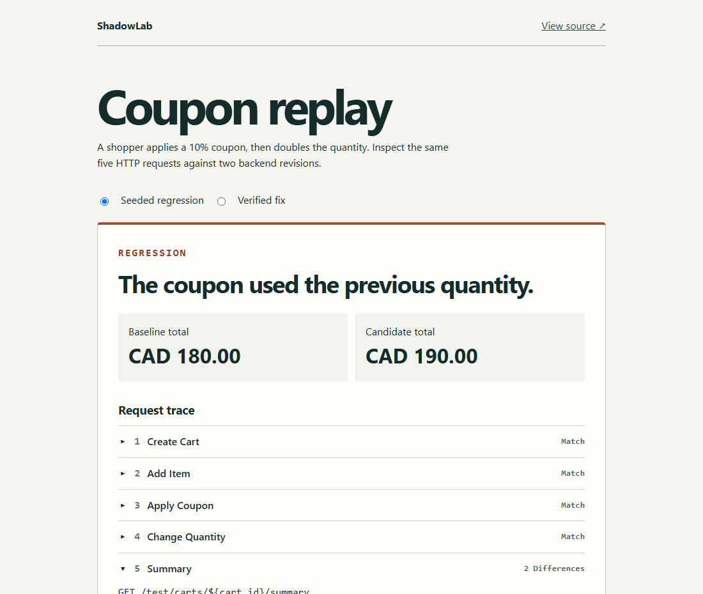
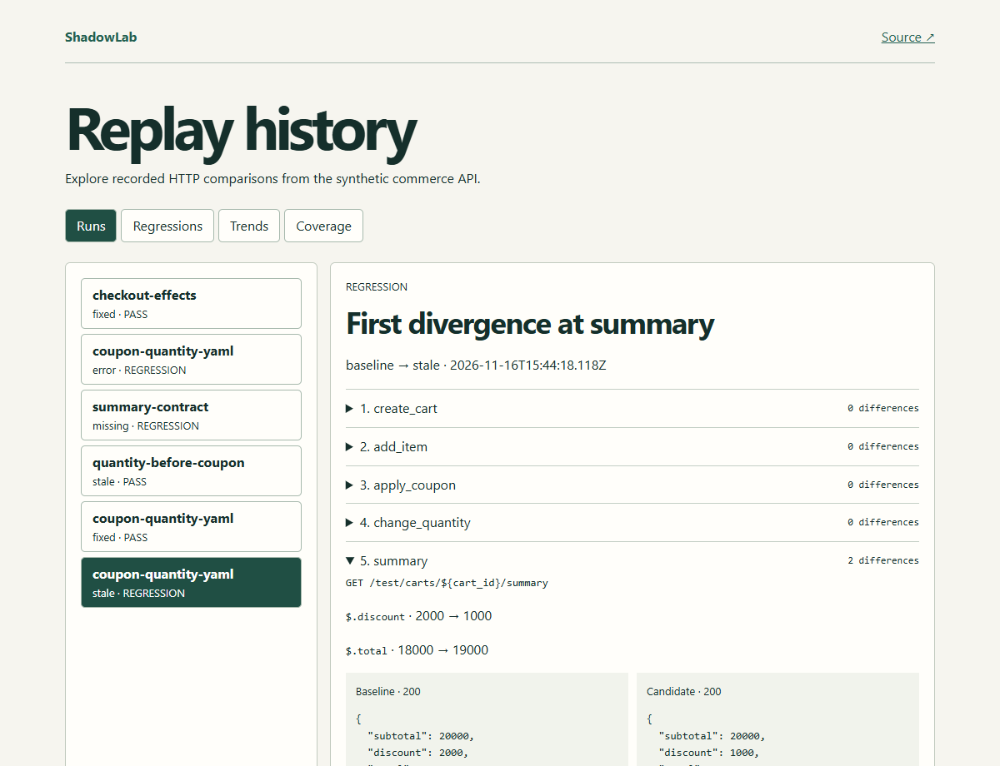

# ShadowLab

[](https://github.com/youssefelaboudy/ShadowLab/actions/workflows/ci.yml)

A shopper adds a CAD 100 item, applies a 10% coupon, then doubles the quantity. Every request succeeds. The candidate charges **CAD 190**. The baseline charges **CAD 180**. ShadowLab replays the journey against both revisions and traces the extra CAD 10 to the summary response.

[Browse replay history](https://youssefelaboudy.github.io/ShadowLab/history/) · [Architecture and operations](docs/architecture.md) · [Explore the recorded replay](https://youssefelaboudy.github.io/ShadowLab/) · [Read the actual diff](docs/example-report.md) · [Inspect the five-step scenario](scenarios/coupon-quantity.json)



## Reproduce it

From a clean checkout with Node.js 24.12 or newer:

```sh
npm ci
npm run demo -- --out artifacts/demo
```

Each explicit output directory must be fresh. Omit the output option for a unique run directory on every invocation. The demo starts three temporary HTTP servers and runs the same scenario twice. Open `artifacts/demo/stale/report.md` for the failed comparison and `artifacts/demo/fixed/report.md` for the repair. Both directories contain machine-readable JSON. On Windows, double-click **Open Demo.cmd** to run the comparison and open the saved report viewer.

## What happens at step five

| Response field | Baseline | Candidate |
|---|---:|---:|
| Subtotal | CAD 200 | CAD 200 |
| Discount | CAD 20 | CAD 10 |
| Total | CAD 180 | CAD 190 |

The faulty revision saves the item count when the coupon is applied. The repaired revision reads the current quantity when building the summary. Both totals balance internally. Detecting this defect requires comparing the business outcome across versions.

## Compare two Git commits

The tagged baseline and candidate contain different source code. A replay from fresh checkouts first diverges at the fifth request. Both commit SHAs and the fixture checksum are in the report. [Actual Git comparison](docs/git-replay/report.md) · [Commands and reusable GitHub Action](docs/revisions-and-ci.md)

## Run the history dashboard

Run `docker compose -f compose.history.yaml up --build --wait` and open `http://127.0.0.1:4200`. Queue a replay, inspect grouped regressions, explore daily outcomes and see which response fields each route covered. PostgreSQL coordinates two workers and indexes immutable reports in a SeaweedFS S3 bucket. The hosted dashboard is a read-only snapshot of six real replays. [Operations and retention](docs/architecture.md) · [Three-minute demo](docs/demo-script.md) · [Blueprint acceptance record](docs/blueprint.md)



## How replay works

1. **Validate the scenario.** The JSON and YAML contracts require a fixture, UTC clock, ordered steps and known demo routes. Variables must be captured before use.
2. **Create isolated state.** Each fixture handshake allocates a fresh in-memory SQLite database, clock and local notification sink. The runner releases that lease in a cleanup block. Overlapping replays have separate databases.
3. **Resolve identities independently.** Each revision creates random cart and item IDs. The runner substitutes that revision’s IDs into later paths and represents the IDs by their capture names in evidence.
4. **Compare the responses.** Status codes, known response fields, missing values, currency assertions and integer-cent totals are compared. A configured timestamp can be ignored. Array ordering is significant in the comparator.
5. **Keep the evidence.** Reports retain sanitized request templates, both response projections, the first divergent step, subsequent differences, fixture clock and scenario checksum. CI includes the checkout SHA.

## Commands

```sh
node packages/cli/main.ts scenario validate scenarios/coupon-quantity.json
npm run record -- --out artifacts/recording
npm run coverage
node tools/export.ts artifacts/demo
```

Recording is opt-in on the owned synthetic API. Successful requests become replayable templates with named captures. Only recognized fixture fields are copied. Headers and unknown fields never enter the recording. A separate evidence file captures response snapshots and recording-scoped placeholders for selected private references. The response projection retains typed demo fields. Extending the demo to a new response field requires extending that projection and its tests.

To exercise separate processes, run `docker compose up --build --wait`, then:

```sh
docker compose exec baseline node packages/cli/main.ts replay --scenario scenarios/coupon-quantity.json --baseline http://127.0.0.1:4101 --candidate http://127.0.0.1:4102 --out /tmp/evidence
docker compose cp baseline:/tmp/evidence artifacts/run-001
node packages/cli/main.ts report artifacts/run-001 --format markdown
docker compose down
```

Replay exits **0** for a match, **1** for a regression, and **2** for invalid input, infrastructure failure or an unusable baseline. The guided demo exits zero after verifying the expected failure and repair.

## Verification and scope

The local Node 26.12.1 suite passed 25 tests, with **98.68% core line coverage** and **90.50% branch coverage**. The coverage job publishes its own measurements for every checkout. The test suite exercises three seeded failures (stale discount, missing currency and HTTP 500), recorder privacy, replayable recordings, concurrent isolation, duplicate notification effects and bounded HTTP failures. The coverage command measures the schema, replay engine and comparator with an 85% line-coverage gate. CI also builds both containers, verifies the regression exit code and uploads reports for 14 days.

This implementation supports a single owned commerce API and sequential JSON workflows. SQLite keeps the one-command demo self-contained. The Compose services use a shared loopback namespace with external networking disabled. Notifications are local events. The runner accepts literal IPv4 loopback origins, rejects redirects, and caps each response at 64 KiB and four seconds. The public dashboard displays exported runs. The optional local React dashboard uses PostgreSQL, two workers and S3-compatible artifact storage. Rebuild it after changing the scenario using the demo and export commands above.


## Measured replay evidence

The synthetic benchmark repeated the five-step coupon scenario ten times against each of four revisions. All 30 injected failures first diverged at the summary. All ten corrected runs matched. The runner normalized 80 independently generated cart and item bindings across those 40 replays. Each revision produced identical sanitized step evidence across its ten fresh fixture pairs. Median local replay times ranged from 18 to 27 ms on Windows with Node 26.12.1. Timings include both HTTP replays and fixture creation and cleanup on already-running servers. [Benchmark results](docs/benchmark.json) · [Benchmark code](tools/benchmark.ts)

A second saved scenario moves the quantity change ahead of the coupon. Both revisions then return CAD 180. The passing control isolates the order dependency. [Control scenario](scenarios/quantity-before-coupon.json)

Run `node tools/benchmark.ts` to repeat the measurements. Use `asciinema play docs/terminal.cast` to view the captured CLI run. The browser report above displays its underlying requests and responses. [Recorded terminal session](docs/terminal.cast)
