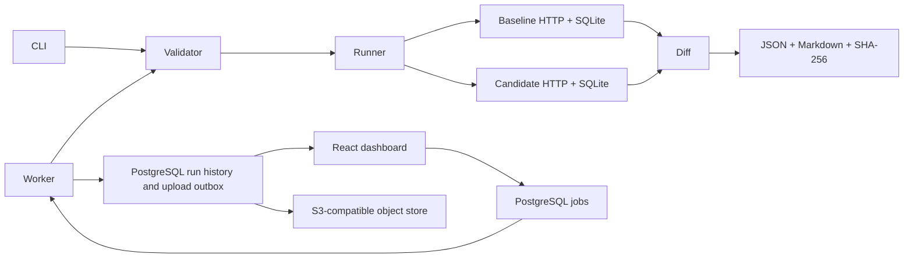

# From a saved workflow to a reproducible diff

The standalone runner validates the scenario and fixture before making requests. Each target returns a distinct lease, its Git revision and a checksum of the fixture it loaded. Each HTTP operation uses only its own lease. A clean SQLite database contains all mutable application state. The fake clock and integer-cent pricing come from the fixture contract. Random IDs exercise remapping across runs.

The recorder projects successful operations into a scenario and a separate evidence file. Allowed customer references become recording-scoped HMAC pseudonyms. Authorization, cookies, addresses and arbitrary body fields never enter either file. The payment and email adapters append local events. Compose replay shares a loopback namespace with external networking disabled. The history workers use an internal Docker network for PostgreSQL and S3 traffic. The dashboard binds its published port to host loopback and checks the origin on browser writes.

The validator accepts JSON and YAML. The published JSON Schema describes the authoring format. Runtime validation also checks the route contract, earlier variable definitions, supported selectors, fixture fields, and bounded timeouts. Polling repeats GET requests up to the configured attempt limit. Object keys have no comparison order. Arrays retain their order unless the scenario declares an identity key. A duplicate identity makes keyed comparison ambiguous and stops that run.

Workers claim one job per process using PostgreSQL row locks and SKIP LOCKED. Priority increases with prior failures for the scenario. Workers renew a lease during execution. Completion requires the same lease, so a delayed process cannot overwrite its replacement. Losing a worker makes its job eligible after 30 seconds. Three attempts exhaust the retry budget. The default Compose stack runs two workers.

Completion saves the run, normalized per-environment results, differences, and both artifact payloads in one transaction. An upload outbox retries delivery to content-addressed S3 keys. The index exposes the SHA-256 and delivery state. Retention deletes stored objects and the associated database records. CLI publication stages complete artifacts on the same filesystem and renames them into a fresh run directory.

## Operating the history service

Run `docker compose -f compose.history.yaml up --build --wait` and open `http://127.0.0.1:4200`. Set `SHADOWLAB_COMMIT` to the checkout SHA at build time to stamp container runs. In PowerShell use `$env:SHADOWLAB_COMMIT = git rev-parse HEAD`. On a POSIX shell use `export SHADOWLAB_COMMIT=$(git rev-parse HEAD)`.

Schedule a scenario, choose a candidate and inspect the first divergent step. The other views aggregate groups, daily outcomes and compared response fields for the current page of runs. The public Pages snapshot uses the same React interface and loads saved evidence. The local service refreshes queue and history from PostgreSQL every 2.2 seconds.

Use `docker compose -f compose.history.yaml up -d --scale worker=3` to change concurrency. Use `docker compose -f compose.history.yaml exec dashboard node tools/expire-history.ts 14` to remove runs older than fourteen days. Local disk reports use `node packages/cli/main.ts prune artifacts --days 14`. Only complete checksummed local artifacts with known filenames are eligible. GitHub Actions retains its uploaded artifacts for fourteen days.

Set `OTEL_EXPORTER_OTLP_TRACES_ENDPOINT` to an authorized local OTLP HTTP collector before running the CLI. Each target execution emits a span with child HTTP-step spans. Attributes contain scenario, step and method. The adapter test starts an actual collector and verifies delivery.

## Boundaries

The replay protocol covers a single owned synthetic application. It does not capture production sessions. Polling supports finite deterministic readiness transitions. Event ordering across multiple services is outside the blueprint's scope. The local dashboard is a developer tool with a loopback deployment boundary. Its development credentials are for the private Compose network.
